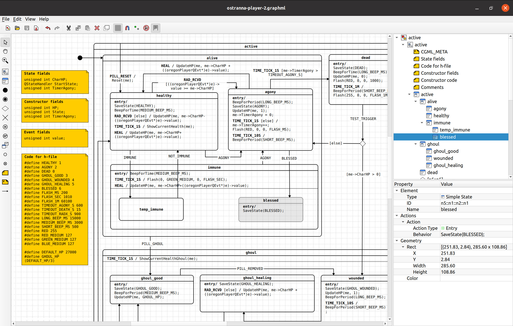
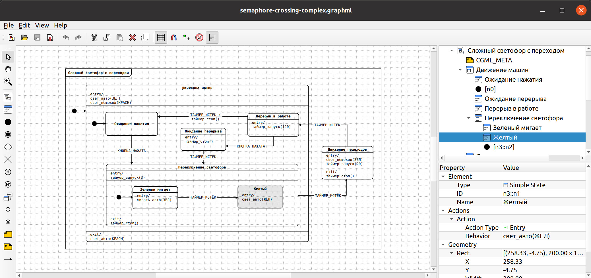
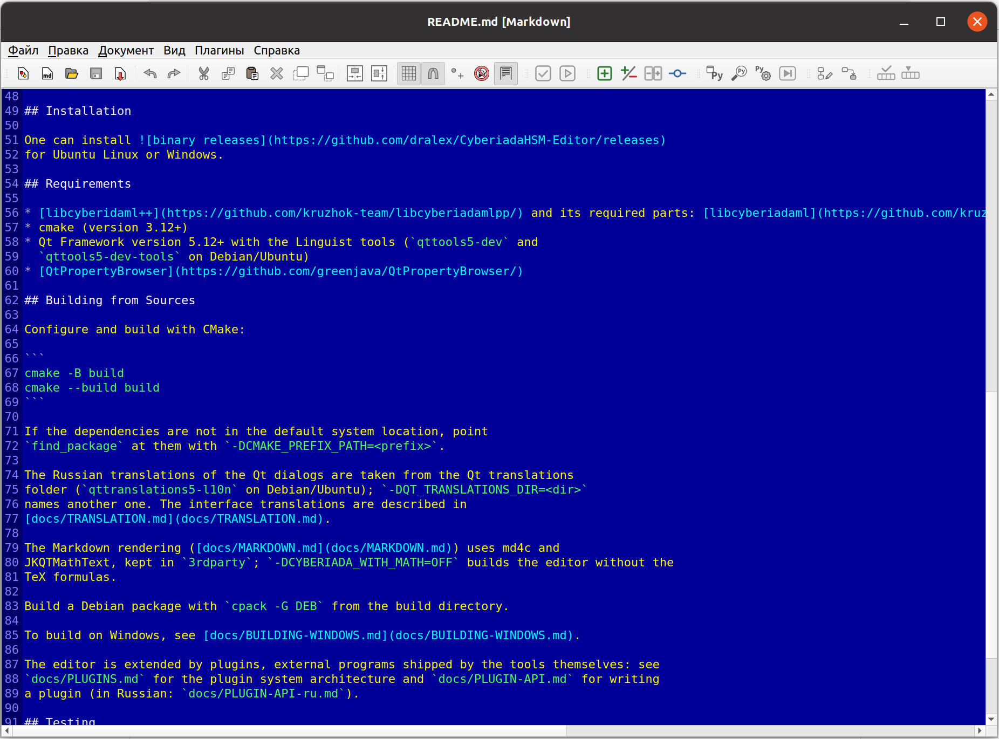

# CyberiadaPro — профессиональная среда разработки и редактор Cyberiada расширенных иерархических машин состояний (ПРИМС)


Десктопная среда разработки и визуальный редактор диаграмм ПРИМС проекта Кибериада, базирующийся на
библиотеке Qt. 

Код программы распространяется под лицензией GNU Public License (версия 3),
а документация -- под лицензией GNU Free Documentation License (версия 1.3).

## Редактор

С помощью редактора можно создавать диаграммы и сохранять их в формате
Cyberiada GraphML. Редактор поддерживает множество форматов диаграмм ПРИМС.
Редактор дает возможность изображать множество элементов диаграмм
(состояния, псевдосостояния, переходы и пр.), управлять обзором (зум,
перетаскивание вида), копировать/вставлять объекты, делать отмену операций и
т.п. Несколько документов открываются одновременно во вкладках с общим буфером
обмена.

Код в действиях, условиях и формальных комментариях подсвечивается по
языку платформы `platformLanguage` документа (C, C++, C#, Python; правила в
каталоге `syntax/`), который выбирается в меню «Документ ▸ Язык кода» (Document > Language).
Неформальные комментарии в формате Markdown также подсвечиваются (меню «Документ ▸ Разметка»,
Document > Markup).

У каждой вкладки есть режим (меню «Документ ▸ Режим»): диаграмма ПРИМС,
диаграмма конечного автомата (КА) или текст - простой, Markdown, JSON или исходный код на
C, C++, C# или Python с подсветкой; любую вкладку можно также сделать доступной только для
чтения (вкладка Markdown только для чтения показывает отформатированный документ с
формулами TeX и изображениями SVG). В текст Markdown изображение вставляется командой
«Правка ▸ Вставить изображение», перетаскиванием или из буфера обмена: оно копируется
рядом с текстом, его можно обрезать, повернуть или уменьшить. Команда «Правка ▸ Вставить
диаграмму» добавляет диаграмму как изображение SVG со ссылкой на файл .graphml, а «Документ ▸
Обновить изображения диаграмм» заново экспортирует изображения изменившихся диаграмм: каждое
SVG хранит свою исходную диаграмму в метаданных. Команда «Документ ▸ Проверить» (F7) находит
битые ссылки текста Markdown: отсутствующие файлы и изображения, якоря без заголовков,
устаревшие изображения диаграмм. Команда «Правка ▸ Вставить ссылку» (Ctrl+K) ссылается на
заголовок этого или другого текста, на файл или адрес; щелчок по `file.md#anchor` открывает
текст на этом заголовке. Команда «Вид ▸ Предпросмотр» показывает отформатированную страницу
рядом с исходным текстом во время работы и следует за курсором. Панель «Оглавление»
показывает заголовки текста Markdown деревом, а его изображения - листьями; щелчок переходит
к месту в тексте, дерево следует за курсором, двойной щелчок открывает диаграмму.

Редактор поддерживает поиск, сравнение текстовых файлов и другие полезные
функции среды разработки.







## Плагины

Редактор поддерживает систему плагинов (см. ),
позволяющи обрабатывать диаграммы ПРИМС и запускать программы под управлением диаграмм ПРИМС.
Плагин может также работать с текстовыми вкладками, добавлять языки программирования своего
инструмента и передавать вкладке сравнения базовую ревизию диаграммы.
Примеры интересных плагинов:

* : создание диаграмм ПРИМС с использованием языковых больших моделей;
* : запуск диаграмм ПРИМС с кодом на Python;
* : запуск диаграмм конечных автоматов;
* : генерация и проверка кода для нод ROS2 на Python; 
* : запуск диаграмм ПРИМС по управлению черепашки ROS2;

## Git

Редактор сам показывает и изменяет git-репозиторий активной вкладки
([docs/GIT.md](docs/GIT.md)): панель «Репозиторий» перечисляет файлы рабочей копии с их
состоянием, деревом папок или по состояниям; меню Git добавляет файлы в индекс и убирает их
оттуда, отменяет изменения, делает коммит, сравнивает диаграмму или текст с HEAD, индексом
или ревизией во вкладке сравнения, показывает историю и переключает локальные ветки.
Редактор запускает программу git (в Windows — Git для Windows). Чтобы `git diff` в командной
строке показывал диаграммы по их элементам, задайте драйвер textconv `cybparser listing` из
libcyberiadaml:

    echo '*.graphml diff=cyberiada' >> .gitattributes
    git config diff.cyberiada.textconv "cybparser listing"

В Windows `cybparser.exe` устанавливается рядом с `CyberiadaPro.exe`; в Git Bash:

    git config diff.cyberiada.textconv '"C:/Program Files/CyberiadaPro/cybparser.exe" listing'

## Установка

Для установки доступны 
под ОС Ubuntu Linux и Windows.

## Требования

* Библиотека [libcyberidaml++](https://github.com/kruzhok-team/libcyberiadamlpp/)
  и ее зависимости: [libcyberiadaml](https://github.com/kruzhok-team/libcyberiadaml),
  [libhtreegeom](https://github.com/kruzhok-team/libhtreegeom), а также libxml2 
* cmake (версия 3.12+)
* Библиотека Qt версии 5.12+ с инструментами Linguist (`qttools5-dev` и
  `qttools5-dev-tools` в Debian/Ubuntu)
* [QtPropertyBrowser](https://github.com/greenjava/QtPropertyBrowser/)

## Сборка из исходников

Для конфигурации и сборки проектов используется CMake:

```
cmake -B build
cmake --build build
```

Если зависимости не усановлены глобально, добавляйте при сборке параметр
`-DCMAKE_PREFIX_PATH=<prefix>`, чтобы правильно указать директорию для
`find_package`.

Русский перевод стандартных диалогов Qt берется из каталога переводов Qt
(пакет `qttranslations5-l10n` в Debian/Ubuntu); другой каталог задается
параметром `-DQT_TRANSLATIONS_DIR=<dir>`. Переводы интерфейса описаны в
[docs/TRANSLATION.md](docs/TRANSLATION.md).

Отображение Markdown ([docs/MARKDOWN.md](docs/MARKDOWN.md)) использует библиотеки md4c и
JKQTMathText из каталога `3rdparty`; параметр `-DCYBERIADA_WITH_MATH=OFF` собирает редактор
без формул TeX.

Пакет под дистрибутив семейства Debian можно получить командой `cpack -G DEB`
из директории сборки.

Для сборки под Windows есть отдельная инстукция: [docs/BUILDING-WINDOWS.md](docs/BUILDING-WINDOWS.md).

## Тестирование

Редактор имеет консольную систему тестирования и режим исполнения команд в
командной строке, который опирается на режим offscreen библиотеки Qt. После
сборки проекта запустите скрипт `./run-tests.sh` из корня репозитория. Также
изучите документ `docs/TESTING.md`, описывающий архитектуру системы
тестирования, режим консольного исполнения команд и уровни тестирования. Еще
можно изучить документация к тестовому полигону с применением ИИ-агентов:  
`docs/POLYGON.md` (испытание плагинов — `docs/POLYGON-PLUGINS.md`).
