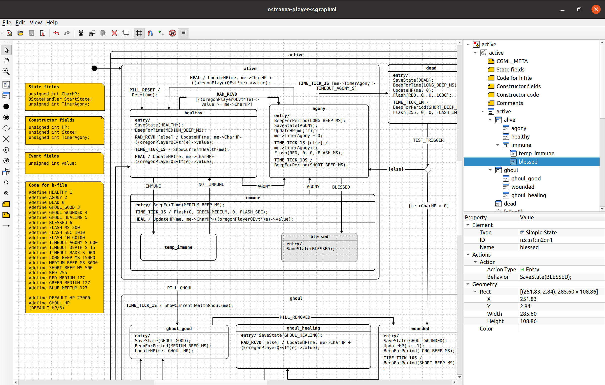
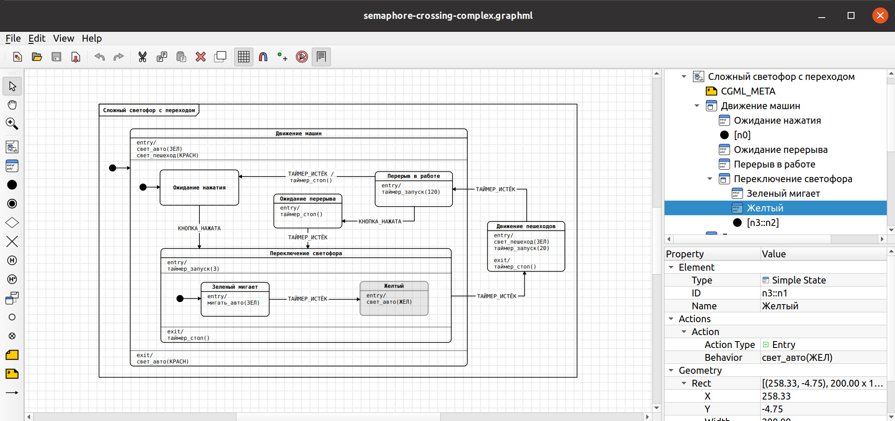

# CyberiadaPro — the Cyberiada Hierarchical State Machines Editor


The visual editor program for Cyberiada HSM graphs based on the Qt Framework.

The code is distributed under the GNU Public License (version 3), the documentation -- under
the GNU Free Documentation License (version 1.3).

## The Editor

The editor is able to create HSM diagrams and edit Cyberiada GraphML files.
It suports multiple HSM formats and has many drawing tools - HSM diagram
elements (states, pseudostate, transitions, etc.), view management (zoom,
pan), copy/paste, undo/redo, etc. Several documents are open at once in tabs,
with the clipboard shared between them. The code in the actions, guards and formal
comments is highlighted by the `platformLanguage` of the document (C, C++, C#,
Java, JavaScript, Python; the rules are in `syntax/`), chosen in Edit > Language.
The informal comments in Markdown are highlighted as well (Edit > Markup).





## Installation

One can install 
for Ubuntu Linux or Windows.

## Requirements

* [libcyberidaml++](https://github.com/kruzhok-team/libcyberiadamlpp/) and its required parts: [libcyberiadaml](https://github.com/kruzhok-team/libcyberiadaml), [libhtreegeom](https://github.com/kruzhok-team/libhtreegeom) and libxml2 
* cmake (version 3.12+)
* Qt Framework version 5.12+ with the Linguist tools (`qttools5-dev` and
  `qttools5-dev-tools` on Debian/Ubuntu)
* [QtPropertyBrowser](https://github.com/greenjava/QtPropertyBrowser/)

## Building from Sources

Configure and build with CMake:

```
cmake -B build
cmake --build build
```

If the dependencies are not in the default system location, point
`find_package` at them with `-DCMAKE_PREFIX_PATH=<prefix>`.

The Russian translations of the Qt dialogs are taken from the Qt translations
folder (`qttranslations5-l10n` on Debian/Ubuntu); `-DQT_TRANSLATIONS_DIR=<dir>`
names another one. The interface translations are described in
[docs/TRANSLATION.md](docs/TRANSLATION.md).

Build a Debian package with `cpack -G DEB` from the build directory.

To build on Windows, see [docs/BUILDING-WINDOWS.md](docs/BUILDING-WINDOWS.md).

The editor is extended by plugins, external programs shipped by the tools themselves: see
`docs/PLUGINS.md` for the plugin system architecture and `docs/PLUGIN-API.md` for writing
a plugin (in Russian: `docs/PLUGIN-API-ru.md`).

## Testing

The editor has a console test system based on the batch mode and the Qt
offscreen platform. Build the project, then run `./run-tests.sh` from the
repository root. See `docs/TESTING.md` for the testing architecture, the
batch mode contract and the test layers, and `docs/POLYGON.md` for the
agent-driven test polygon.

