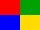

# Outline

A code span `` holds no image.

## Images

 beside 

```
# not a heading

```

#### A skipped level

[](../diagrams/geometry.graphml)

Setext heading
--------------

# Second 

Another
=======
